 

  

## 👨‍💻 About me

I'm a final-year **B.E. in AI & Data Science** student at **VESIT** (graduating 2027). I like turning raw data into forecasts, dashboards and clear answers. I'm building toward a **Data Analyst** career and exploring **Data Engineering** next.

<b>🎓 Education</b> (click to expand)

 

**Bachelor of Engineering, AI & Data Science** - VESIT, Mumbai
Expected graduation: **May 2027** · CGPA **8.10** (through Sem 6)

<b>💼 Experience</b> (click to expand)

 

| Role | Company | When |
|---|---|---|
| Data Science Intern (AI) | Xylofy (remote) | June 2026 |
| Data Analytics Intern | CodeAlpha (remote) | June 2026 |

Both were 1-month internships working on company-provided sales datasets.

<b>🎯 What I'm working on right now</b> (click to expand)

 

- Strengthening **SQL** and **Power BI** for analyst roles
- Learning the basics of **data pipelines / ETL** (theory first, hands-on next)
- Preparing for campus placements

## 🧰 Tech stack

  

<b>🌱 Learning / basic level</b> (click to expand)

 

Java (DSA practice) · LangChain & RAG (basics) · Apache Airflow (concepts) · AWS (certified at foundation level)

## 🚀 Featured projects

  
  

  

## 🏅 Certifications

<b>Click to view</b>

 

- AWS Cloud Foundations
- AWS Cloud Developing
- AWS Academy Generative AI Foundations
- NVIDIA DLI - Fundamentals of Deep Learning
- Deloitte Data Analytics Job Simulation (Forage)

## 📊 GitHub stats

  
  

  

## 🐍 Contribution snake

  <picture>
    <source media="(prefers-color-scheme: dark)" srcset="https://raw.githubusercontent.com/themanroshan/themanroshan/output/github-snake-dark.svg"/>
    
  </picture>

### 📫 Let's connect

I'm open to **Data Analyst / Data Engineer internships and entry-level roles**.

Thanks for stopping by! ⭐ Feel free to explore my repositories.

